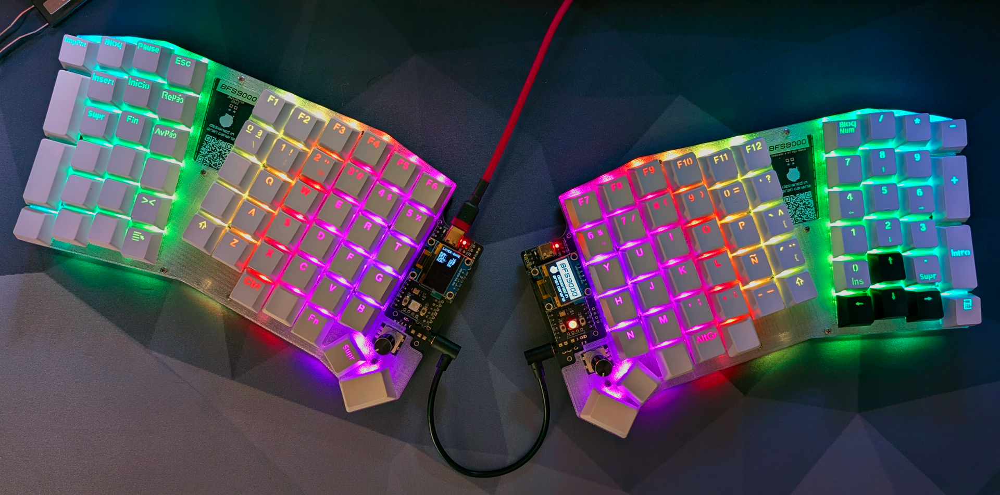

# BFS9000



BFS9000 is a custom split keyboard designed by Jesús Guillén. It runs QMK Firmware and includes per-key RGB Matrix lighting, an OLED display on each half, a rotary encoder and an optional Azoteq TPS65 (IQS5xx) trackpad on the right half.

* Keyboard Maintainer: [Jesús Guillén](https://github.com/jguillen-lab)
* Hardware Supported: BFS9000 PCB
* Hardware Availability: [BFS9000 repository](https://github.com/jguillen-lab/BFS9000)

Make example for this keyboard, after setting up your build environment:

```
make jguillen_lab/bfs9000:default
```

Flashing example for this keyboard:

```
make jguillen_lab/bfs9000:default:flash
```

See the [build environment setup](https://docs.qmk.fm/newbs_getting_started) and the [make instructions](https://docs.qmk.fm/newbs_building_firmware) for more information.
